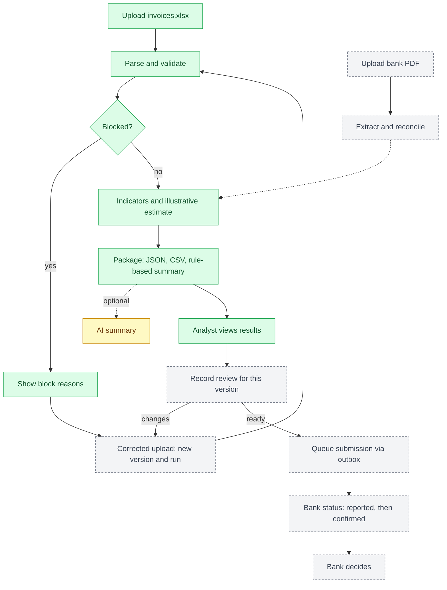

# Qawafel Technical Assessment — Written Answers
**Graduate Software Engineer · Tasks 01, 02, 04 and 05**

> **Prototype (Task 03):**
> - **Live demo:** https://sara-sme-financing.streamlit.app — no sign-in, API key or payment needed.
> - **Repository:** https://github.com/sara7kj/qawafel-financing-prototype. The `README.md` there explains how to run it locally, the sample data and the assumptions.
>
> All bundled sample and test data is synthetic. The optional AI summary is not enabled on the demo and has not been tested against a live AI service.

An SME wholesaler provides 12 months of invoices (Excel) and bank statements (PDF), and Qawafel prepares a package for a partner bank to review. My approach makes the package **trustworthy before it is fast**:
- validate every record and explain every exclusion;
- compute a few transparent indicators;
- show what is unknown as unknown;
- leave every credit decision with the bank.

The prototype builds the invoice side end to end. PDF statements, storage, authentication and the bank connection are designed below, not built. The linked documents add detail; the answers here stand on their own.

---

## Task 01 — Requirements

**Users:**
- the **wholesaler**, who uploads the data and fixes problems;
- the **Qawafel analyst**, who validates and prepares the package, and is the primary user of the prototype;
- the **bank reviewer**, who receives a consistent package and decides.

**Definitions:**
- Valuation date (VD) 2026-09-30; reporting period (RP) 2025-10-01 to 2026-09-30.
- Amounts in SAR, computed exactly to the halala.

| # | Story | Key acceptance criteria (testable) |
|---|---|---|
| US-01 | As a wholesaler, I upload one workbook in a documented format | `.xlsx` only. A missing sheet or column **blocks** analysis and names what is missing |
| US-02 | As a wholesaler, I see which records have problems | Each issue shows sheet, Excel row, record ID, rule and class (BLOCK / QUARANTINE / OUT OF PERIOD / WARN). CSV download. An explicit "no issues" state |
| US-03 | As an analyst, I see what was excluded and why | Defective records are quarantined, never silently dropped. Analysis is blocked only for structural failures (S-01, S-02) or when **no valid invoice remains** (S-03); a high share of excluded records does not block. Excluded amounts are recorded values, never summed across duplicates or currencies |
| US-04 | As an analyst, I see monthly sales and collections separately | All 12 months appear. Sales exclude VAT; collections are cash as recorded; they are never subtracted. A month or total affected by a defective record is **N/A with a reason**, never 0 |
| US-05 | As an analyst, I see receivables aging at VD | An invoice due on VD is *Current*; one due a day earlier is *1–30*. Buckets add up to the total. Settlements after VD are ignored and counted |
| US-06 | As an analyst, I see customer concentration | Top 5 by net sales and top 5 by open receivables. A warning (R-20) above an experimental 30%, compared before rounding |
| US-07 | As an analyst, I trust balances with partial payments and credit notes | Settlements reduce only their own invoice. An over-settled invoice, or one with a defective linked record, is removed from receivables. It stays in sales **only if it is itself valid and in the reporting period** |
| US-08 | As an analyst, I see an illustrative financing estimate | Rate × reliable eligible receivables (at most 90 days overdue). The rate is adjustable from 0 to 100%. Labelled "illustrative – not a bank policy or credit decision". N/A when links are unresolved |
| US-09 | As a bank reviewer, I receive one JSON package | Indicators with their scopes, quality status, exclusions, warnings and disclaimers. Unavailable values are `null` with a reason. Numbers match the screen |
| US-10 | As a bank reviewer, I see the limitations | Collections are labelled unverified. `source_completeness_verified` is always false. A "not a credit decision" disclaimer |
| US-11 | As an analyst, I get an optional AI summary | Built only from computed facts; every number comes from the package; labelled as AI. The app works fully without it |

**Questions for the customer before building:**
- **Bank:** Which product and eligibility rules? Which package format and indicators are expected? Is there a real advance-rate policy?
- **Data:** What does a real export look like? Are payments linked to invoices? How are returns recorded? Are net, VAT and total available, and is everything in SAR? Are there stable customer IDs? Should we use a fixed reporting period, and should older open invoices count?
- **Process:** Who approves the package? Which consent and retention rules apply? How should unverifiable data be shown?

**What can go wrong with the data:**

| Risk | Handling |
|---|---|
| Unreadable file; missing or duplicated columns; no valid invoice | **BLOCK**: block reasons only, no figures |
| Duplicate or missing IDs; invalid amounts or dates; non-SAR; net + VAT ≠ total | **QUARANTINE** every affected copy; never auto-corrected; linked records excluded as dependents |
| A defective payment or credit note on a valid invoice | That invoice leaves receivables. N/A propagates by rule to the affected month (or the whole series if the date is unknown) and to the totals and ratios that depend on it. Payments excluded **only** because their invoice is quarantined do not make a month N/A |
| A link to an unknown invoice; settlements above the invoice total (R-13) | Unresolved links make the estimate N/A; R-13 removes the invoice from receivables, with its cause shown |
| Records after VD or outside the period | **OUT OF PERIOD**: excluded and counted; not a defect |
| Empty months, name variants, high concentration | **WARN**: shown, with no change to the calculations |
| Collections not matched to bank statements; an incomplete export; fabricated invoices | Stated **limits**: they cannot be proven from invoice data alone |

*Detail:* `docs/requirements.md`, `docs/data-design.md`.

---

## Task 02 — Technical specification

### Data model
**Input (built):** `CUSTOMER 1─* INVOICE 1─* PAYMENT` and `INVOICE 1─* CREDIT_NOTE`.
- Amounts are integer halalas.
- Every loaded row keeps its Excel row number and raw values.
- Validation gives each row one status (`accepted`, `quarantined`, `out_of_period` or `dependent`).

**Persistent model (designed):**
| Entity | Purpose |
|---|---|
| `application` | The financing request |
| `ingestion_attempt` | Every pull, including failed ones with no file |
| `source_file` | An immutable file version with hash and provenance |
| `source_row` | Every row as read, with an **internal row ID** separate from the business ID, so defective and duplicated rows can be stored |
| `validation_run`, `record_result`, `issue` | Outcomes per run and per row |
| `bank_transaction` | Extracted statement lines, for reconciliation |
| `package` | An immutable version with a content **fingerprint** |
| `review`, `submission` | Both bound to one package and fingerprint |
| `outbox_message`, `audit_event` | Reliable sending and the audit trail |

### API (designed; the prototype runs the same steps as library functions)
| Endpoint | Purpose |
|---|---|
| `POST /v1/applications` | Create a request |
| `POST /v1/applications/{id}/files` | New file version |
| `POST /v1/applications/{id}/validation-runs` | Validate and compute → `ok` or `blocked` |
| `GET /v1/validation-runs/{id}/issues` | Issues as JSON or CSV |
| `POST /v1/validation-runs/{id}/packages` | Build a package version (`advance_rate_percent` 0–100) |
| `POST /v1/packages/{id}/reviews` | Review **this** version and fingerprint |
| `POST /v1/packages/{id}/submissions` | Queue this exact version with an `Idempotency-Key`; `202` only after the submission and outbox rows are committed |
| `GET /v1/submissions/{id}` | The recorded bank status (reported, not proven) |

**Errors** use one problem-details shape and never expose raw exceptions or credentials:
| Status | `code` | When |
|---|---|---|
| 400 | `invalid_request` | Invalid input |
| 409 | `invalid_state` | Submitting without a valid review of this version |
| 409 | `idempotency_conflict` | The same key was sent with a different body |
| 422 | `validation_blocked` | A package was requested from a blocked run |
| 503 | `submission_not_recorded` | Nothing was queued |

### Process flow

**Key:** green = built · yellow = built but optional and offline-tested only · grey = designed.

**Built vs designed:**
- **Built:** validation (S-01–S-03, R-01–R-21), indicators, the estimate, the package and CSV, the rule-based summary, a results screen, and the data generator.
- **Designed:** API, storage, authentication, review recording, PDF statements, and the bank integration.

**Key decisions:**
- integer halalas and exact fractions;
- quarantine and propagate instead of dropping;
- one export contract;
- review and submission bound to a fingerprint;
- hand-specified expected results as test oracles.

*Detail:* `docs/technical-specification.md`.

---

## Task 04 — Integration judgment (wrong status 3% of the time, no sandbox)

**First, understand the 3%:**
- What is "wrong": stale, a wrong value, the wrong application, or unknown?
- Which statuses and endpoints are affected?
- Is it 3% of reads or 3% of applications? If of reads, about one read in 33 is wrong.
- Is the error sticky across reads and webhooks? Can a status go backwards?
- Which source can the bank designate as authoritative for confirmation?

**How we integrate safely:**
1. **The bank decides; we record what it reports.** We keep `reported_status` and `confirmed_status` separately.
   - A repeated GET, or a webhook that agrees with a GET, can repeat the same error, so it is **not** confirmation.
   - Confirmation needs a source the **bank designates in writing**, linked to the application and the status time and not affected by the same fault, or a recorded human confirmation through an agreed bank channel.
2. **Decisions need confirmation; progress does not.** Decision statuses are confirmed before anyone acts. Progress statuses are shown as "reported" and never close an application.
   - A newer report that contradicts a confirmed status opens a **conflict**, stops any action, and keeps the earlier evidence.
3. **Sending never silently duplicates.**
   - Read errors are simply retried.
   - A POST timeout, a dropped connection, or a 5xx not guaranteed as "not processed" means **delivery unknown**. We look the submission up by our key or reference first, then resend only with the **same key and body** within the agreed idempotency lifetime. Otherwise a human decides; there is no automatic resend.
   - A duplicate application pauses all sending.
4. **Closing:** only with a confirmed final status, no open delivery, conflict or duplicate issue, and the applicant informed.
5. **No synthetic data in the bank's production** without the bank's written agreement.

**Testing without a sandbox:**
- The bank signs off **contract examples**: requests, responses, errors, webhooks and idempotency behaviour.
- A **local mock bank** simulates timeouts before and after acceptance, 5xx, duplicates, wrong statuses (random or sticky, 3% and higher), out-of-order webhooks and unknown values.
- **Limit:** this proves our behaviour against our understanding of the bank, not the bank's real behaviour.

**Proposed rollout — subject to agreement with the bank:**
1. contract and mock;
2. connectivity, using approved calls only;
3. read-only shadow on real applications, with the manual channel still used, to measure the real error pattern;
4. limited live, with every decision confirmed by a human;
5. a gradual widening.

**Monitoring:** duplicates, unknown deliveries, unconfirmed decisions, mismatch rate and error rates, with a manual or automatic pause. All thresholds are **PROPOSED**. The mismatch rate over confirmed items is not comparable to the bank's 3% until the definitions and denominators match.

**What I would say to the bank:**
> "We want to integrate safely, and we will not act on a status we cannot confirm. Help us understand the 3%: what 'wrong' means, which statuses it affects, how it was measured, and whether it can repeat on the next read. With no sandbox, we propose signed contract examples tested against a local mock, then read-only checks on applications you approve; no test data goes to your production without your written agreement. We need an idempotency key and a lookup by our reference, so a retry never creates a second application, and an authoritative way to confirm decisions, with a named contact. Until then, we confirm every decision with your team by hand."

**Decisions to leave the call with:** the error definition and pattern, the confirmation source, idempotency and lookup, the contract examples, permission per rollout phase, limits and contacts, and an owner for fixing the 3%.

*Detail:* `docs/bank-integration-plan.md`.

---

## Task 05 (bonus) — Automating the request

**This is a future plan; none of it is built.** No merchant or bank API is assumed, and data arriving automatically is not treated as proof that it is correct or complete.

| Priority | Data source | Impact / effort / risk |
|---|---|---|
| **1st** | **Saved export profile** for one accounting system: the merchant exports a ready file, with no reformatting (3–5 pilot merchants, PROPOSED) | High / low / low. Targets what we expect to be the most common manual error, the wrong format (to confirm with a baseline). No stored credentials; reuses the current validation |
| 2nd | **Scheduled export** to an agreed channel | Medium-high / medium / medium (incomplete or stale drops) |
| In parallel | **PDF statement extraction** (designed) | High for trust: it enables collection reconciliation |
| 3rd | **API connector** to an accounting or e-invoicing system, only if one exists and the merchant consents | High / high / medium-high |
| Last | **Authorised bank account-information channel**, only where available and permitted | High / high / high |

Staying with a manual upload or an export profile is a valid outcome.

**Data handling:**
- Every pull is recorded as an attempt, **including failures with no file**. Partial files are kept for diagnosis only.
- A transfer check confirms the structure, and compares counts or totals with the source's own figures when they exist. Otherwise record completeness is "not proven".
- Each pull is a full 12-month immutable snapshot. Versions are compared only on IDs that are present and unique. Changed data creates a new package version that needs a new review.
- Freshness is judged on the last successful update, not on the latest transaction date, because an old transaction may simply mean no activity.

**Where a human stays:** approving export mappings, correcting ambiguous data, reviewing every package version, confirming consequential bank statuses, and the credit decision (the bank).

**How we know it is better.**

*Compared with the manual flow* (a baseline is measured first):
- **Preparation time:** from the start of the request to the package being ready to submit.
- **Manual interventions per application:** uploads, re-uploads, corrections, reformatting and support contacts.
- **First-run error rate:** applications whose first validation is blocked.
- **Bank correction rate:** the share of submitted packages for which the bank asks for corrections or more data.

*New metrics for automated pulls* (no manual baseline exists):
- **Transfer completeness:** the share of pulls that pass the transfer check, and how many of those were matched to the source's own figures.
- **Update freshness:** the time since the last successful update.
- **Pull failure rate.**

All targets are **PROPOSED**, and **no results have been measured yet**. Automation counts as better only if quality stays the same or improves.

**Rollout and fallback:** baseline → export-profile pilot → scheduled export run alongside the manual upload → scheduled export by default. A per-merchant switch can turn it off, and the **manual upload always remains** as the fallback.

*Detail:* `docs/automation-plan.md`.

---

## AI tools used
- **Development:** I used **Claude Code** (Anthropic's Claude) as a coding and writing assistant. It drafted the code, the tests and the documents from my instructions, ran the tests, and proposed fixes.
- **My role:** I set the requirements and decisions, and reviewed each phase.
- **Technical review:** I also used ChatGPT/Codex for technical review of the design, selected code, and outputs. It directly executed selected test cases; it did not run the full pytest suite.
- **Expected results:** they were manually specified from the documented worked examples, independently of the implementation under test.
- **Inside the prototype:** the default summary is rule-based (no AI). The optional AI summary has been tested with a fake client only; no live API call has been made.
