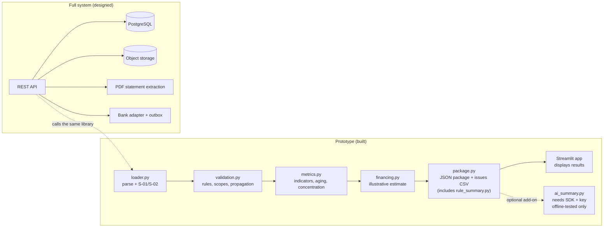
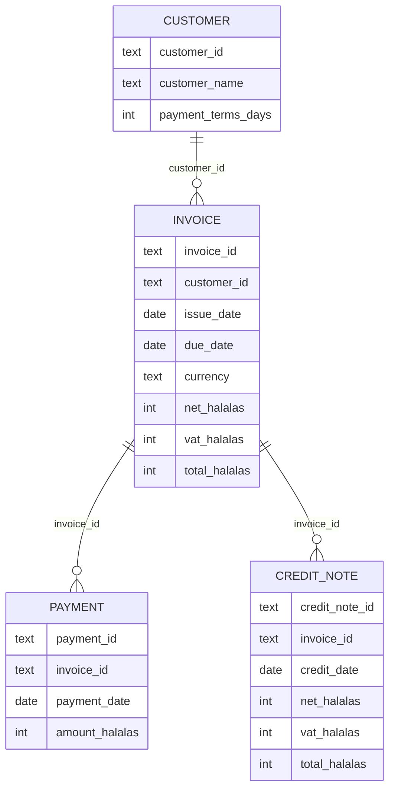
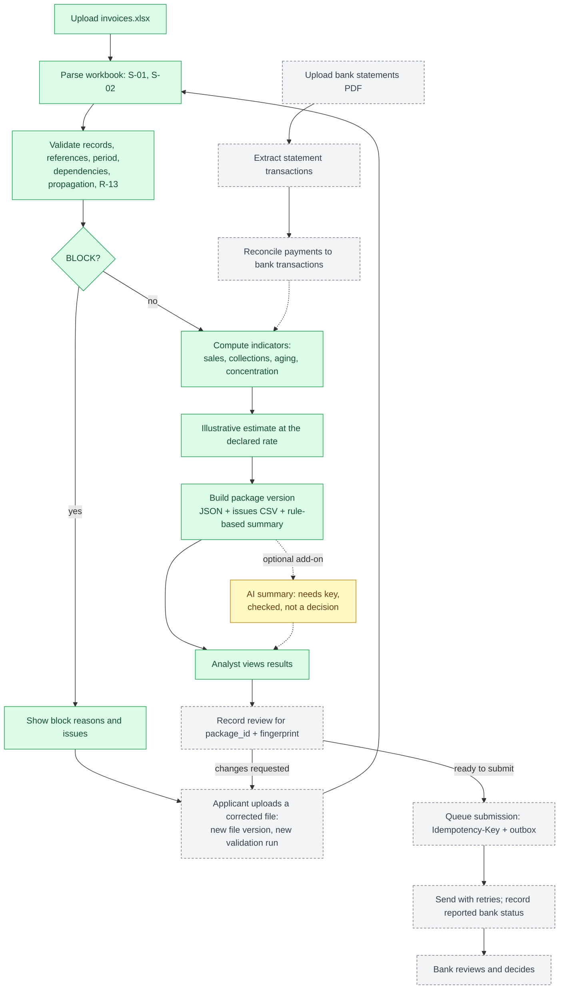
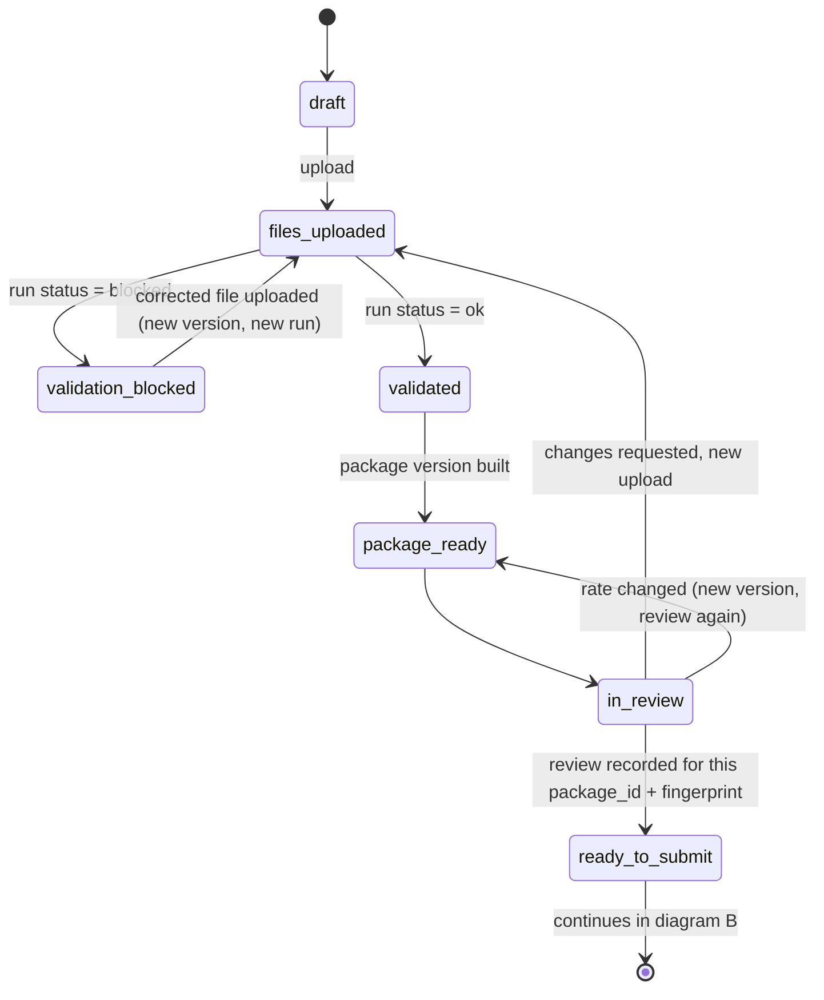
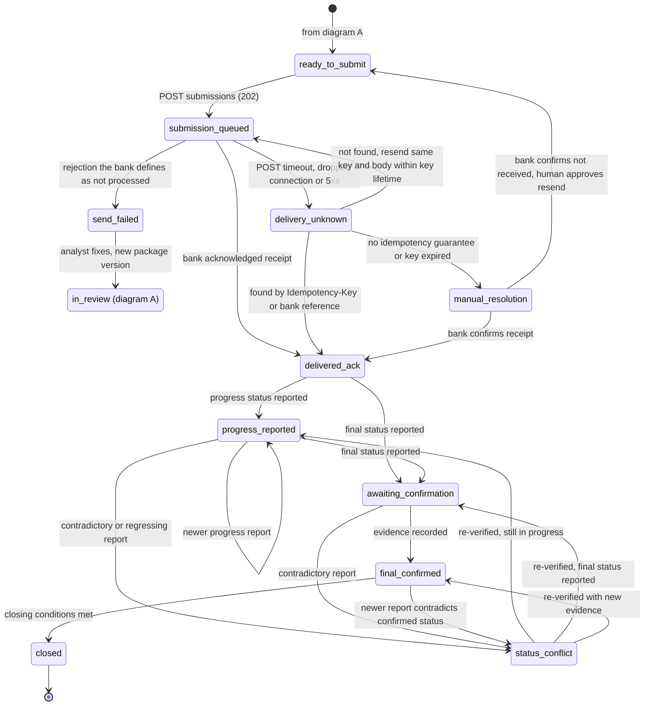

# Technical Specification — SME Financing Package

> **Status:** Approved v0.4 (Task 02 of the Qawafel Graduate SE assessment).
> - **v0.4** adds the designed `ingestion_attempt` entity (§2.2) for recording pulls, including failed ones.
> - **v0.3** aligned §4.2 and §5 with `bank-integration-plan.md`: closing only after confirmation, failure and conflict states, and the resend rules.
> **Inputs:** the official brief, `docs/requirements.md` (approved baseline), `docs/data-design.md` and the current code.
> **Legend:**
> - **[Built]** — implemented and tested in this repository.
> - **[Built — offline-tested only]** — implemented, but not verified against a live external service.
> - **[Designed]** — proposed for the full system; no code yet.

---

## 1. Scope and context
A wholesaler uploads 12 months of invoices (Excel) and bank statements (PDF). Qawafel turns them into a checked, structured package that a partner bank reviews.

**The prototype builds the invoice half of that flow:**
- load, validate, compute indicators and apply the illustrative financing assumption;
- build the JSON package, which includes the rule-based summary;
- a local screen that displays the results.

**[Designed] in this document:** PDF statements, storage, authentication, the review workflow and the bank integration.



**Design principle:**
- The business logic is a plain Python library, `src/financing`, with no dependency on Streamlit or on the AI SDK.
- The UI, a future API and the tests all call the same functions.

---

## 2. Data model

### 2.1 Input model [Built]
The detailed schema is in `data-design.md` §1–§2 and is not repeated here.



The IDs in this diagram are **business IDs as recorded**. They can be missing or duplicated; validation detects that (R-01, R-03, R-08, R-09) and does not assume they are unique.

**In code:**
- Every row becomes a `Record` that keeps its Excel row number, its raw cell values, its parsed values and any field errors.
- Validation assigns each record a `RecordStatus`: `accepted`, `quarantined`, `out_of_period` or `dependent`.
- It also raises `Issue`s with one of four problem classes: BLOCK, QUARANTINE, OUT OF PERIOD or WARN.
- Invoice state: an invoice can be **receivable unreliable**, with one `UnreliableReason` per cause (e.g. R-13).

### 2.2 Persistent model [Designed]
The store must keep **every row we need to inspect**, including defective and duplicated ones, and every version of every file. So the **internal row identity** is kept separate from the **business ID** written in the file.

| Entity | Key fields | Notes |
|---|---|---|
| `applicant` | `applicant_id`, legal_name, cr_number | |
| `application` | `application_id`, applicant_id, status, reporting_period, valuation_date | The financing request. States are in §4.2 |
| `source_file` | `source_file_id`, application_id, kind (`invoices_xlsx` / `bank_statement_pdf`), **version**, sha256, storage_key, uploaded_by, uploaded_at | Each upload is a new immutable version. The file bytes live in object storage |
| `ingestion_attempt` | `attempt_id`, application_id, source (`manual_upload` / export profile / connector), requested date range, started_at, finished_at, status (`succeeded` / `failed`), failure_reason, `transfer_complete` result, `source_file_id` (optional) | One row per pull, **including failed pulls that produced no file**. A partial file, if any, is linked here for diagnosis and never used in a validation run. Used by the future automation (`automation-plan.md` §4) |
| `source_row` | **`row_id`** (internal UUID), source_file_id, sheet, excel_row, **business_id** (nullable text), raw_values (JSON), parsed_values (JSON) | Every row is stored as read: valid, defective, duplicated or blank-ID. **There is no uniqueness constraint on `business_id`** |
| `validation_run` | `run_id`, source_file_id, rules_version, status (`ok` / `blocked`), receivables_quality, created_at | One run per source-file version; immutable |
| `record_result` | run_id, row_id, status (`accepted` / `quarantined` / `out_of_period` / `dependent`), rules, dependent_on_row_id | The outcome per row and per run. Duplicate business IDs appear here as quarantined rows |
| `issue` | issue_id, run_id, row_id (nullable), class, rule, column, raw_value, affected_invoice, message | Same fields as the issues CSV |
| `receivable_state` | run_id, invoice row_id, rule, cause_row_id | Receivable-unreliable invoices and their causes, including R-13 |
| `bank_statement`, `bank_transaction` | statement period, masked account, txn date, amount_halalas, reference, source_row_id | Output of PDF extraction (§5) |
| `package` | `package_id`, run_id, **version**, advance_rate_percent, content (export JSON), **fingerprint** (SHA-256 of `content`), created_at | Immutable. Any change of file or rate creates a new package version |
| `review` | review_id, **package_id + package_fingerprint**, reviewer_id, action (`ready_to_submit` / `changes_requested`), note, created_at | Applies to exactly one package version. It is **not** a credit decision |
| `submission` | submission_id, **package_id + package_fingerprint**, idempotency_key, status, bank_reference, attempts, last_status_at | Sends exactly the reviewed package (§3.3) |
| `outbox_message` | message_id, submission_id, payload_ref, attempts, next_attempt_at, sent_at | The stored intent to send; worked by a retrying sender (§5) |
| `audit_event` | actor, action, entity, entity_id, at | Append-only |

**Business-ID matching:**
- Matching by business ID, e.g. a payment's `invoice_id` to an invoice, happens **only inside one `source_file` version and its `validation_run`**, never across versions or applications.
- Indexes on `(source_file_id, sheet, business_id)` are **non-unique**: they support lookup and duplicate detection, and never reject a stored row.

**Storage conventions:** amounts are `BIGINT` halalas; dates are `DATE`; internal IDs are UUIDs.

---

## 3. API design [Designed]

The prototype exposes **Python functions**, not HTTP. The REST API below is a thin layer over them:
`load_workbook_file` → `validate` → `compute_metrics` → `estimate_financing` → `build_package` / `issues_csv`.

**Conventions:**
- JSON over HTTPS, versioned under `/v1`.
- Amounts are decimal strings with 2 places; unavailable values are `null` with a `reason`.
- Lists are paginated with `?limit=&cursor=`.

### 3.1 Endpoints

| Method & path | Purpose | Input | Success |
|---|---|---|---|
| `POST /v1/applications` | Create a financing application | `{applicant_id}` | `201` `{application_id, status: "draft"}` |
| `GET /v1/applications/{id}` | Status and links | – | `200` |
| `POST /v1/applications/{id}/files` | Upload a source file (new version) | multipart: `file`, `kind` | `201` `{source_file_id, version, sha256}` |
| `POST /v1/applications/{id}/validation-runs` | Validate one file version and compute indicators | `{source_file_id}` | `201` `{run_id, status: "ok" \| "blocked", record_counts, receivables_quality}` |
| `GET /v1/validation-runs/{run_id}/issues` | Issue table | `?class=&rule=`; `Accept: text/csv` for CSV | `200` |
| `POST /v1/validation-runs/{run_id}/packages` | Build a package version | `{advance_rate_percent: 0–100}` | `201` package resource (§3.2) |
| `GET /v1/packages/{package_id}` | Read a package version | – | `200` package resource |
| `POST /v1/packages/{package_id}/reviews` | Record the analyst review for this version | `{package_fingerprint, action, note}` | `201` |
| `POST /v1/packages/{package_id}/submissions` | Queue this exact version for the bank | header `Idempotency-Key`; `{package_fingerprint}` | `202` `{submission_id, status: "queued"}` |
| `GET /v1/submissions/{submission_id}` | Submission status as recorded | – | `200` `{status, bank_reference, last_status_at}` |
| `POST /v1/bank/webhooks` | Bank status callback, if offered | signed body | `204`. Stored as a reported status (§5) |

### 3.2 Package resource vs export JSON
The API wraps the export JSON; it does not change it.
- **`content`** is exactly what the prototype exports today (`financing_package.json`).
- **The resource metadata sits outside `content`:** `package_id`, `version`, `fingerprint`, `run_id`, `created_at`.

```http
POST /v1/validation-runs/7f3c…/packages
{"advance_rate_percent": 70}

201 Created
{
  "package_id": "a91e…", "version": 1, "run_id": "7f3c…",
  "fingerprint": "sha256:5d2b…", "created_at": "2026-10-21T08:00:00Z",
  "content": { "package_version": "1.0", "status": {"blocked": false}, "indicators": {…},
               "financing_estimate": {"value": "1040901.47", "advance_rate": "0.7000", …},
               "automated_summary": {…}, "ai_summary": {"value": null, "reason": "not requested"}, … }
}
```

### 3.3 Review and submission are bound to one version
- **A review applies to exactly one `package_id` and its `package_fingerprint`.**
- **A submission sends that same package.** When accepting a submission, the API checks:
  1. the latest review of **this** `package_id` is `ready_to_submit`;
  2. the review's fingerprint equals the package fingerprint, and the submitted `package_fingerprint` matches both.
- **No inheritance.** A new file version or a new advance rate creates a **new package version**, which needs its own review. It never inherits the approval of an earlier version.
- **Atomic acceptance.** `202` is returned only after the `submission` row and its `outbox_message` are committed in **one database transaction**. If that commit fails, the API returns an error (`503 submission_not_recorded`), nothing is queued, and the client can retry with the same `Idempotency-Key`.
- **Later bank failures** (timeouts, 5xx, wrong statuses) are recorded on the submission. They never change the response of a request that was already accepted.

### 3.4 Errors
Errors use one JSON shape (RFC 9457 problem details):
`{type, title, status, detail, code, errors: [{field, message}]}`.
Raw exception text and credentials are never returned.

| Status | `code` | When |
|---|---|---|
| 400 | `invalid_request` | Missing or invalid field, e.g. an advance rate outside 0–100 or not an integer |
| 401 / 403 | `unauthenticated` / `forbidden` | No token, or the user has no access to this application (§5) |
| 404 | `not_found` | Unknown ID |
| 409 | `invalid_state` | A submission without a valid `ready_to_submit` review for **this** package version and fingerprint. This includes a review of an older version and a fingerprint mismatch |
| 409 | `idempotency_conflict` | The same `Idempotency-Key` was sent with a different body |
| 413 / 415 | `file_too_large` / `unsupported_media_type` | Upload limits; only `.xlsx` and `.pdf` are accepted |
| 422 | `validation_blocked` | A package was requested from a run whose status is `blocked`. `errors` lists the S-01 / S-02 / S-03 issues |
| 429 | `rate_limited` | With `Retry-After` |
| 503 | `submission_not_recorded` | The submission could not be stored locally. Nothing was queued and no `202` was given |

**A BLOCK result is not an error for the validation run itself.** The run is created with `status: "blocked"` and lists its issues.

---

## 4. Process flow

### 4.1 End to end


**Colour key:**
- **Green — built:** the Streamlit screen accepts an `.xlsx` upload and **displays** the results, including the BLOCK reasons.
- **Yellow — optional add-on:** the AI summary, built but offline-tested only.
- **Grey — designed:** PDF extraction and reconciliation, recording a review, the re-upload and version transitions, submission and bank status.

The rule-based summary is part of the package. The credit decision always belongs to the bank.

### 4.2 Application states [Designed]
The states are shown in two diagrams for readability; the logic is the same as one diagram.
- **Diagram A:** the application cycle, up to an approved package (`ready_to_submit`).
- **Diagram B:** submission and bank statuses. It starts at `ready_to_submit`.
- **Shared state:** `in_review` appears in both, because a send failure returns the application to review.

**A. Application cycle up to an approved package**


**B. Submission and bank statuses**


**Submission states:**
- **`delivered_ack`** means only that the bank acknowledged receiving the package.
- **`delivery_unknown`** covers any POST error that may have happened after the bank accepted the request. Its handling is in §5 and in `bank-integration-plan.md` §3.
- **`send_failed`** is used only for responses the bank defines as "not processed".

**Status states:**
- **`progress_reported`** (e.g. `received`, `in_review`) is shown as reported. It needs no final confirmation, and it never closes the application.
- **`awaiting_confirmation`** holds an unconfirmed **final** status (a decision or a withdrawal).
- **`status_conflict`** stops any action based on the status until it is re-verified.
  - A newer report that contradicts a confirmed status opens a conflict.
  - The earlier confirmation, its evidence and the full report history are kept.

**Closing:**
- There is **no direct path** from a reported status to `closed`.
- `closed` requires a confirmed final status and the other conditions in `bank-integration-plan.md` §5.

**No state means credit approval.** The bank's decision is outside this system's guarantees.

---

## 5. Built vs designed

| Capability | Status | Notes |
|---|---|---|
| Excel ingestion (path, bytes or upload) | **[Built]** | Row numbers and raw values are kept. Duplicate known columns block (S-02) |
| Validation rules, scopes, propagation, R-13 | **[Built]** | Requirements §3–§5; order as in data-design §7 |
| Indicators, aging, concentration (R-20) | **[Built]** | Integer halalas, exact fractions, N/A with reasons |
| Illustrative financing estimate | **[Built]** | A declared assumption, not a bank policy |
| JSON package (includes the rule-based summary) and issues CSV | **[Built]** | One export contract |
| AI summary | **[Built — offline-tested only]** | Optional add-on after the package. Needs the SDK and a key. **Not verified against the live service** |
| Results screen (Streamlit) | **[Built]** | Available locally and as a public Streamlit Community Cloud demo, without sign-in. Intended for synthetic data only. It displays results only; it does not record reviews |
| Review recording, re-upload and version transitions | **[Designed]** | §3.3, §4.2 |
| Synthetic data generator and fixtures | **[Built]** | Seeded; content-reproducible |
| REST API | **[Designed]** | §3. The library functions already exist |
| **PDF bank statements** | **[Designed]** | Text extraction first, OCR only as a fallback. Map rows to `bank_transaction`, then match payments by amount, date window and reference. Unmatched items go to the analyst. Collections stay "unverified" until they are matched |
| **Storage** | **[Designed]** | §2.2: PostgreSQL plus object storage, immutable versions, internal row IDs. The prototype keeps results in memory and in the Streamlit session only |
| **Authentication and authorisation** | **[Designed]** | See the access rules below |
| **Bank integration** | **[Designed]** | See the guarantees below |

**Authentication and authorisation:**
- **Sign-in:** OIDC. Every state change is written to the audit log.
- **Applicant:** sees its **own** applications only.
- **Qawafel analyst:** sees the applications **assigned or authorised** to them.
- **Bank reviewer:** sees only the packages **submitted to their bank**.

**Bank integration — guarantees and limits:**
- **Stored intent.** The outbox stores the **intent** to send. The sender retries until delivery is acknowledged, so a send is not lost if the process crashes.
- **Possible duplicates.** Delivery is **at-least-once**, so the bank may receive the same package more than once. Preventing duplicate **processing** at the bank depends on the **idempotency contract agreed with the bank**: the same `Idempotency-Key` and package fingerprint on every retry.
- **Read errors vs send errors.**
  - A failed status read is simply retried; it changes nothing.
  - A POST error that may have happened after acceptance moves the submission to `delivery_unknown`. This includes a timeout, a dropped connection, and a 5xx unless the bank guarantees the request was not processed.
  - We then **look the submission up first** by bank reference or Idempotency-Key.
  - We resend only with the **same key and body**, and only within the agreed idempotency lifetime. Otherwise a person decides (`manual_resolution`), with no automatic resend.
- **Status trust.**
  - A bank-reported status is recorded as **reported**, not as proven. A second read, or a webhook that agrees with a GET, is **not conclusive**, because the same error can repeat.
  - A confirmation source counts only if the bank designates it as a reference source, the evidence identifies the application and the status time, and the source is not affected by the same fault (`bank-integration-plan.md` §4).
- **Task 04:** the confirmation and escalation process (who checks, when, and with which evidence) is left to the Task 04 integration plan. Until then, an unconfirmed status is shown as unconfirmed.

---

## 6. Key technical decisions

| Decision | Reason |
|---|---|
| Logic as a plain Python library, UI separate | Testable without a UI; a future API reuses it unchanged |
| Amounts as **integer halalas**; ROUND_HALF_UP only for VAT generation, the estimate and display | No float drift; results match the hand-worked oracle to the halala |
| Exact `Fraction` ratios; thresholds compared before rounding | 30% is decided on the exact value (e.g. 0.32315 for CUST-003) |
| Fixed reporting period and valuation date | Results are reproducible and explainable; no hidden "today" |
| **Quarantine and propagate** instead of silently dropping | A dropped payment would overstate balances. Affected invoices leave receivables, and affected months or totals become N/A |
| N/A is `null` with a reason; a true zero stays 0 | Unknown values are never shown as zero |
| Internal row identity separate from business IDs | Defective and duplicated rows can be stored and inspected |
| Review and submission bound to package version + fingerprint | The bank receives exactly what was reviewed. A changed rate or file needs a new review |
| One export JSON; API metadata outside `content` | A single contract; the summaries cannot drift from the numbers |
| Hand-written expected results; seeded generator; content-based reproducibility | Tests check behaviour against an independent oracle, not against the code |
| Default summary is rule-based; AI is an optional add-on | The project runs for any reviewer without a key or cost |
| AI writes fact placeholders, never numbers; output checks; uploads not sent | Every number matches the package. Reasoning is still not guaranteed, so the summary is labelled and needs review |

---

## 7. Prototype limits
- **Input:** one workbook format (`data-design.md` §1). Fixed reporting period and valuation date. SAR only.
- **Receivables:** only invoices issued within the reporting period are covered; older open invoices are not in the data.
- **Collections:** recorded by the applicant and **not reconciled** to bank statements. Source completeness cannot be proven.
- **Name matching:** R-18 compares normalised names exactly; there is no fuzzy matching.
- **AI wording checks:** heuristics only.
- **Platform:** no persistence, authentication, review recording, API or bank connection.
- **Performance:** tested on samples of about 1,400 rows, not at production volume.
- **AI summary:** offline-tested only. The live trial was not run because no credentials were configured.

---

## 8. Traceability

| Area | Code | Tests |
|---|---|---|
| Loading, S-01 / S-02 | `loader.py` | `tests/test_loader.py` |
| Rules, scopes, propagation | `validation.py`, `schema.py` | `tests/test_validation.py` (Dataset B cases, Dataset A, worked example) |
| Indicators, estimate | `metrics.py`, `financing.py` | `tests/test_metrics.py` (worked example: SAR 8,988.27) |
| Package, CSV | `package.py` | `tests/test_package.py` |
| Summaries | `rule_summary.py`, `ai_summary.py` | `tests/test_rule_summary.py`, `tests/test_ai_summary.py` |
| UI | `app/streamlit_app.py` | `tests/test_app.py` |
| Sample data | `scripts/generate_invoices.py` | `tests/test_generator.py` |

At the last run, 270 tests passed. Without the AI SDK, 229 pass and the AI tests are skipped.
